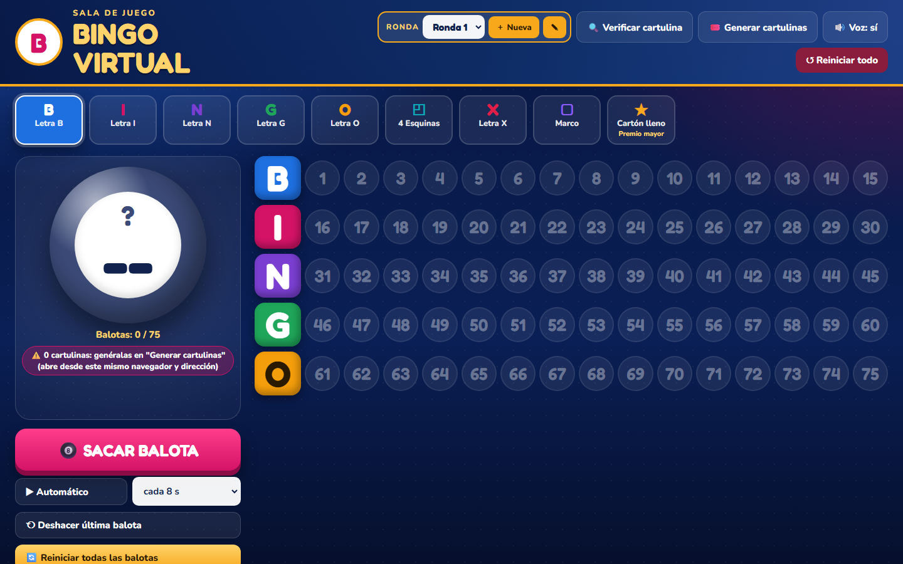
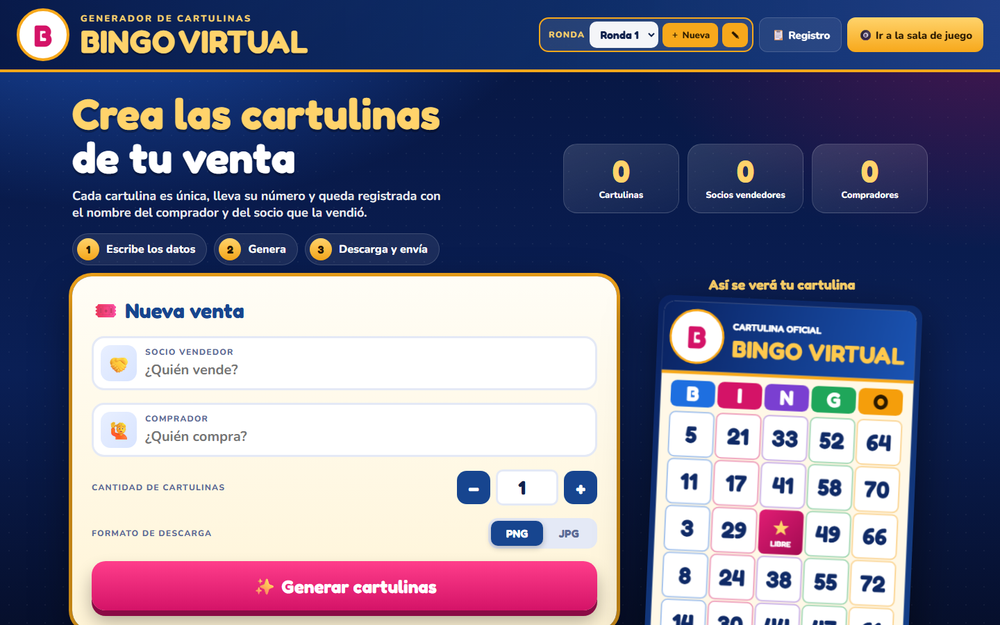

# Bingo Virtual

A browser-based bingo for fundraising events: one page sells and generates unique bingo cards, the other runs the live game on a projector or a video call. No accounts, no internet required.



## What problem it solves

Charity and club bingos often run on paper cards and a spreadsheet of who bought what. This tool generates every card digitally with the buyer's and seller's names, keeps a record of sales, and runs the draw with a big animated board everyone can follow.

## Features

**Card generator (`cartulinas.html`)**

- Unique cards with a serial number, the buyer's name and the seller who sold it.
- Download as PNG or JPG, ready to send by WhatsApp or email.
- Sales register with counters for cards, sellers and buyers.
- Optional custom logo on every card.



**Game room (`index.html`)**

- 75-ball board with B-I-N-G-O columns and an animated ball.
- Win patterns: each letter, four corners, X, frame and full card.
- Automatic draw every few seconds, or manual; undo the last ball.
- The number is read aloud with the browser's speech synthesis (can be turned off).
- Card checker to confirm a winner.
- Several rounds, each with its own cards, balls and winners.

**Data safety**

- Everything is stored in the browser (`localStorage`).
- When launched with the local server, card data is also backed up to `copias/` on disk.

## Run it

Double-click `Iniciar Bingo.bat` on Windows. It starts the small Python server (`servidor.py`, port 8123) and opens both pages. Without Python it opens the HTML files directly.

On any system:

```bash
python servidor.py
# then open http://localhost:8123/index.html and http://localhost:8123/cartulinas.html
```

Open both pages in the same browser so they share the same data.

## Tech

Plain HTML, CSS and JavaScript (no framework, no build step) · Canvas for card images · Web Speech API · Python standard-library HTTP server

## License

[MIT](LICENSE)
